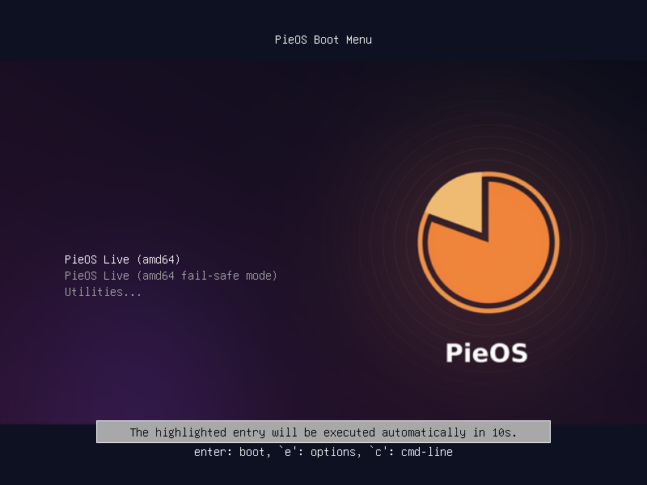
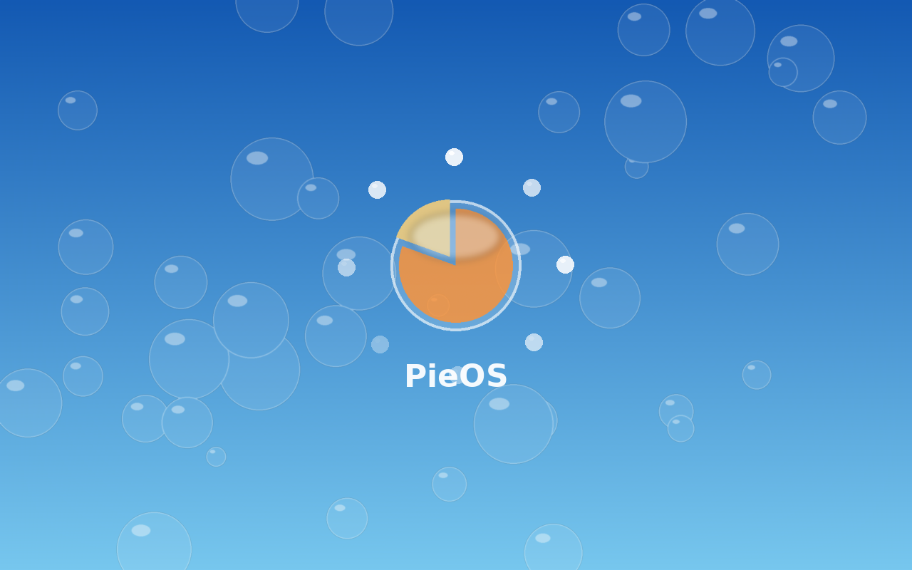
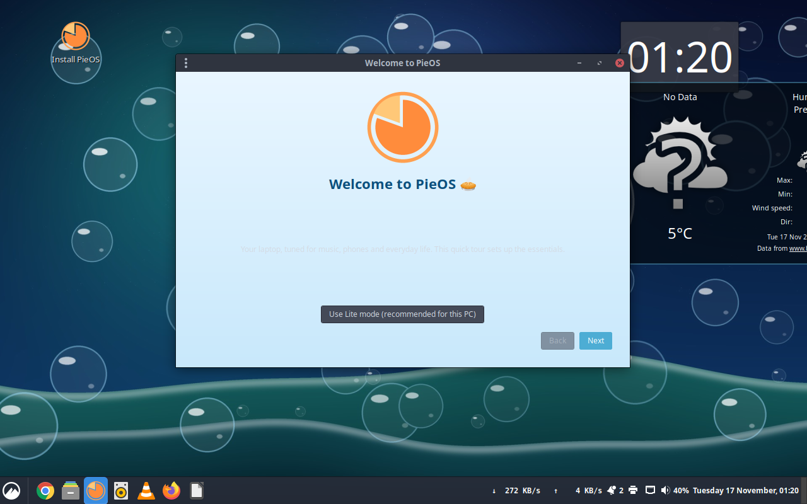
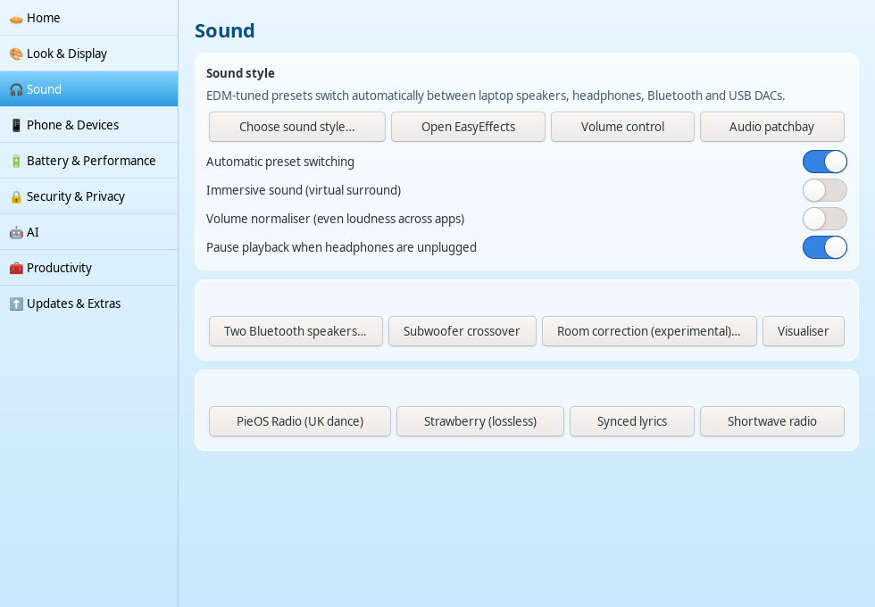
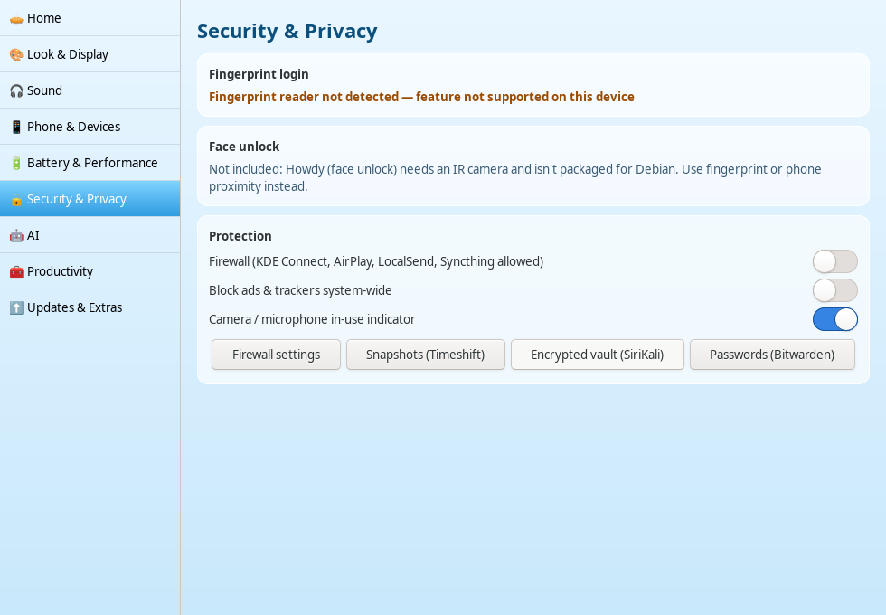

# 🥧 PieOS

PieOS is a desktop Linux built on **Debian 13 "trixie"** (the current Debian stable release). It's set up for everyday browsing, music and phones on Intel laptops, especially **Intel Core Ultra (Meteor Lake / Lunar Lake) with Intel Arc graphics**, and it still boots on 2012-era legacy-BIOS PCs.

**Latest release: [PieOS 1.0](https://github.com/mettir2019-lgtm/pieos/releases/tag/v1.0)** (17 November 2026), amd64, 3.2 GB live + installer ISO.

| | |
|---|---|
|  |  |
|  |  |

## Features

- **Desktop:** Cinnamon (a familiar layout: taskbar at the bottom, menu at the bottom left) with a **Frutiger Aero** look: glossy sky-blue glass by day and deep teal glass by night (switches at London sunset), an accent colour taken from your wallpaper, PieOS wallpapers drawn for 16:9 and 16:10 screens up to 4K, a PieOS boot splash, a PieOS sound pack and an original EDM "drop" at login
- **PieOS Settings** (one place for look, sound, phone, battery, security, AI and updates), a **welcome tour** at first login, and **PieOS Extras** for optional apps
- **Older PCs:** boots on both **UEFI and legacy BIOS** machines, installs with MBR or GPT, and has a **Lite mode** for 4 GB / older-graphics laptops
- **Kernel:** the newest Debian backports kernel (see `BUILD-INFO.txt`), with Intel graphics, Wi-Fi and SOF audio firmware from backports, plus Mesa from backports for the Arc iGPU (xe/i915)
- **Screen mirroring to the PC:** AirPlay Receiver (UxPlay) for iPhone/iPad/Mac, Android Mirror (scrcpy + adb, USB or Wi-Fi) and RustDesk for viewing/controlling Windows PCs
- **Sound:** EasyEffects with automatic EDM-tuned presets for each device, EDM genre presets (House/Techno, Dubstep/DnB, Trance/Progressive, Future Bass/Pop, Big Room), *PieOS Immersive Sound* virtual surround, an RNNoise noise-cancelled mic, and hi-res sample rates for USB DACs
- **Browsers:** Google Chrome (default browser, pinned first on the taskbar, auto-updates from Google's official apt repo), plus Firefox ESR as a second browser
- **Media:** VLC, Rhythmbox, pavucontrol and qpwgraph for audio routing, the **PieOS Speakers** tool for two Bluetooth speakers (same sound on both, or a left/right stereo pair), KDE Connect, full codecs (GStreamer good/bad/ugly/libav, FFmpeg, libavcodec-extra) and Intel hardware video decoding (intel-media-va-driver-non-free)
- **Office and everyday tools:** LibreOffice (en-GB), Image Viewer (Eye of GNOME), Document Viewer (Evince, for PDFs), Calculator, Archive Manager, Disks, GParted, printing (CUPS)
- **Apps:** GNOME Software with Flatpak, and Flathub already enabled
- **System:** PipeWire audio, NetworkManager, Bluetooth (BlueZ and Blueman) with **A2DP sink**, so your phone can stream music to the PC, and **hands-free (HFP)**, so you can take phone calls through the PC, power-profiles-daemon, thermald, and touchpad support via libinput (tap-to-click on)
- **Defaults:** English (UK) language, UK keyboard, Europe/London time zone, hostname `pieos`
- **Installer:** Calamares, shown as **Install PieOS** with the PieOS logo. It uses **btrfs** with `@`/`@home` subvolumes by default, so **Timeshift** snapshots work straight away (ext4 and xfs are also available)

The live session logs in automatically as user `pie` (password `live`, if anything asks for one).

<p align="center"></p>

## Download

The ISO is 3.2 GB, so it's split into four parts on the [v1.0 release](https://github.com/mettir2019-lgtm/pieos/releases/tag/v1.0). Download **all four parts** and the checksum into the same folder:

- [PieOS-amd64.iso.part0](https://github.com/mettir2019-lgtm/pieos/releases/download/v1.0/PieOS-amd64.iso.part0) (800 MiB)
- [PieOS-amd64.iso.part1](https://github.com/mettir2019-lgtm/pieos/releases/download/v1.0/PieOS-amd64.iso.part1) (800 MiB)
- [PieOS-amd64.iso.part2](https://github.com/mettir2019-lgtm/pieos/releases/download/v1.0/PieOS-amd64.iso.part2) (800 MiB)
- [PieOS-amd64.iso.part3](https://github.com/mettir2019-lgtm/pieos/releases/download/v1.0/PieOS-amd64.iso.part3) (678 MiB)
- [PieOS-amd64.iso.sha256](https://github.com/mettir2019-lgtm/pieos/releases/download/v1.0/PieOS-amd64.iso.sha256)

### Join the parts

**Windows** (open **Command Prompt**, not PowerShell, in the download folder):
```bat
copy /b PieOS-amd64.iso.part0 + PieOS-amd64.iso.part1 + PieOS-amd64.iso.part2 + PieOS-amd64.iso.part3 PieOS-amd64.iso
```
(In PowerShell, wrap it: `cmd /c "copy /b PieOS-amd64.iso.part0 + PieOS-amd64.iso.part1 + PieOS-amd64.iso.part2 + PieOS-amd64.iso.part3 PieOS-amd64.iso"`.)

**Linux / macOS:**
```bash
cat PieOS-amd64.iso.part0 PieOS-amd64.iso.part1 PieOS-amd64.iso.part2 PieOS-amd64.iso.part3 > PieOS-amd64.iso
```

The joined file must be exactly **3,227,459,584 bytes**.

### Check the SHA256

Expected: `ba52b00d6905be5ab9ee0db3988f3c9dfcd31578191c11eba37b4524642ec112`

- **Windows (PowerShell):** `Get-FileHash .\PieOS-amd64.iso -Algorithm SHA256` (or in Command Prompt: `certutil -hashfile PieOS-amd64.iso SHA256`)
- **Linux:** `sha256sum -c PieOS-amd64.iso.sha256` (prints `PieOS-amd64.iso: OK`)
- **macOS:** `shasum -a 256 PieOS-amd64.iso`

If it doesn't match, download the parts again; one of them is incomplete.

## Write it to a USB stick

Use an 8 GB or larger stick. **Everything on the stick will be erased.**

- **balenaEtcher (Windows/macOS/Linux, easiest):** install from https://etcher.balena.io, then click **Flash from file** → `PieOS-amd64.iso`, **Select target** → your stick, then **Flash!**
- **Rufus (Windows):** choose the stick and `PieOS-amd64.iso`, click **START**, and when asked pick **"Write in DD Image mode"**.
  > ⚠️ **Old legacy-BIOS PCs (around 2012, e.g. Sony VAIO):** you **must** use **DD Image mode**. Rufus's default "ISO Image mode" puts Rufus's own GRUB on the stick, which doesn't match PieOS 1.0's GRUB modules. Those PCs then stop with `Welcome to GRUB! out of range pointer` or hang. DD mode writes the ISO exactly as built and boots normally. (The next PieOS ISO uses SYSLINUX for legacy BIOS, which avoids this.)
- **Linux (dd):**
  ```bash
  lsblk                                    # find the stick, e.g. /dev/sdX (not a partition like sdX1)
  sudo dd if=PieOS-amd64.iso of=/dev/sdX bs=4M status=progress conv=fsync
  ```

## Boot and install

1. Plug in the stick, restart, and open the boot menu: **F12** (Dell, Lenovo), **F9** (HP), **Esc/F2** (ASUS/Acer) or **F11** (MSI).
2. **Secure Boot can stay on**: PieOS uses Debian's signed shim, GRUB and kernel.
3. Older PCs boot the same stick in **legacy BIOS / CSM** mode (choose the entry without "UEFI:").
4. Try everything in the live session, then double-click **Install PieOS**. The installer uses btrfs with `@`/`@home` (Timeshift-ready), and supports *Install alongside* Windows, full-disk encryption, and MBR or GPT.

## Updates

Installed PCs update themselves daily on mains power: Debian (apt), Google Chrome and Flatpak. PieOS's own new features come through the **update channel** in [`updates/`](updates/): [`updates/channel.json`](updates/channel.json) lists each release, its ISO parts and its update pack with SHA256 checksums. From PieOS 1.1 the updater reads it and verifies every download before applying it. Weekly updates are published as new GitHub Releases.

## Changelog

### 1.1 (planned; being staged for the first weekly update)
- PieOS Speakers: swap left/right on a stereo pair; the combined two-speaker output is only the default while both speakers are connected, otherwise sound falls back to the laptop speaker.
- 2-in-1 / tablet, multi-monitor and all-in-one scaling support (touchegg gestures, Onboard keyboard, per-display DPI scaling).
- Welcome tour text contrast fix for the night theme.
- Lunar Lake laptops (e.g. Lenovo Yoga Slim 7 14ILL10): internal speakers fixed (Cirrus Logic cs42l43 firmware, newer SOF firmware).
- Dual boot: GRUB now detects Windows and other systems (os-prober).
- Legacy-BIOS USB boot: SYSLINUX for the BIOS boot path (next ISO).
- Bluetooth: two speakers at once no longer fail with "Unable to select SEP" (BlueZ 5.83 fixes backported to 5.82).
- PieOS Radio: a visible Stop button (in the notification, the station list and the app's right-click menu).
- Updater: follows this GitHub update channel with SHA256 verification.

### 1.0 (17 November 2026)
- First release. Debian 13 trixie + backports kernel 7.2.12, Mesa 26.1.6, PipeWire 1.6.9; Cinnamon 6.4 with the Frutiger Aero day/night theme; PieOS Settings and welcome tour; EasyEffects EDM presets and Immersive sound; Bluetooth A2DP sink + HFP; AirPlay receiver, Android mirroring, KDE Connect; Chrome + Firefox ESR; Calamares installer with btrfs + Timeshift; UEFI (Secure Boot) and legacy BIOS boot.

## Notes

- PieOS is based on Debian and includes Debian's non-free firmware and Google Chrome (from Google's apt repository). Each bundled package keeps its own upstream licence.
- Report problems through [GitHub Issues](https://github.com/mettir2019-lgtm/pieos/issues).
